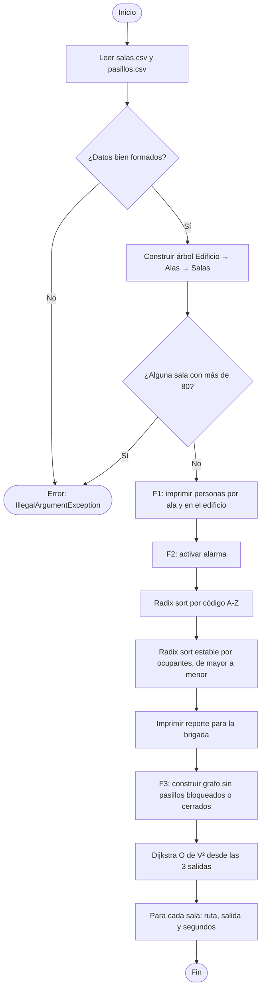
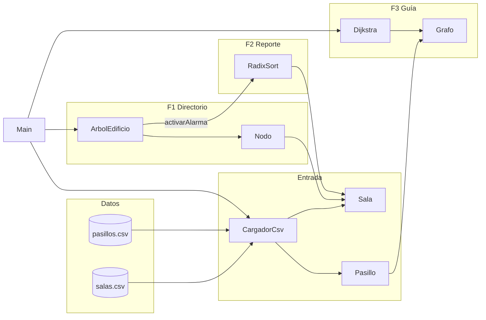
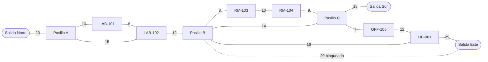

# Examen 2 — Versión B: Salida Segura

Sistema de evacuación de un edificio universitario: directorio de ocupantes por ala, reporte para la brigada y guía de evacuación por sala.

## Autores

- Santiago Portuguez Hernández — 2025072534
- José Miguel Alfaro Chan — 2022437485

## Requerimientos del sistema

### F1. Directorio del edificio

- **Nombre estructura o algoritmo:** Árbol n-ario
- **Complejidad temporal:** O(h) cada sala tiene que actualizar, sea h=400
- **Alternativa descartada:** Lista simple O(n), para no revisar todos los datos
- **Requerimientos:**
  - RF-01: Seguridad debe poder listar las salas de un ala.
  - RF-02: Actualizar ocupantes de una sala.
  - RF-03: Obtener cantidad de personas en cualquier ala o en el edificio.
  - RNF-01: Ninguna sala puede tener más de 80 personas.

### F2. Reporte para la brigada

- **Nombre estructura o alg:** Radix sort
- **Complejidad temporal:** O(n)
- **Alt descartada:** Merge sort, se descarta porque es O(n log n)
- **Requerimientos:**
  - RF-01: se activa la alarma.
  - RF-02: lista las 400 salas de más a menos ocupantes.
  - RNF-01: en caso de empate, se listan por sala de A-Z.
  - RNF-02: debe durar menos de 1s.

### F3. Guía de evacuación

- **Nombre de estructura o algoritmo:** Dijkstra (no usa caminos cerrados), two-way
- **Complejidad temporal:** O(V²)
- **Alt descartada:** BFS, no toma en cuenta el costo del tiempo
- **Requerimientos:**
  - RF-01: para cada sala indica a los ocupantes qué salida usar y qué pasillos seguir.
  - RNF-01: Tienen que salir lo más rápido posible.
  - RF-02: indicar los segundos estimados.
  - RNF-02: Debe descartar rutas con pasillos cerrados o reportados como bloqueados.
  - RNF-03: Solo puede usar alguna de las 3 salidas disponibles.

### Datos

Alas: Oeste = LAB-101, LAB-102. Central = RM-103, RM-104. Este = OFF-105, LIB-001.
Los pasillos se pueden recorrer en ambos sentidos y sus tiempos están en segundos. Los datos completos están en [`src/main/resources/pasillos.csv`](src/main/resources/pasillos.csv) y [`src/main/resources/salas.csv`](src/main/resources/salas.csv).

## Instalación y ejecución

**Requisitos**

- JDK 17 o superior. Gradle 9 necesita un JDK con el que pueda ejecutarse; se probó con JDK 21.
- Gradle 8 o superior.

JUnit 5 se descarga solo la primera vez que se compila.

```bash
git clone https://github.com/Saportu/Examen-2-AED1.git
cd Examen-2-AED1
```

Ejecutar el programa. Muestra las personas por ala y en todo el edificio, el reporte para la brigada y la guía de evacuación de las seis salas:

```bash
gradle run
```

Ejecutar las pruebas unitarias:

```bash
gradle test
```

El reporte HTML de las pruebas queda en `build/reports/tests/test/index.html`.

Si el JDK por defecto no es compatible con Gradle, indique uno de forma explícita, por ejemplo en macOS:

```bash
JAVA_HOME=/Library/Java/JavaVirtualMachines/jdk-21.jdk/Contents/Home gradle test
```

## Estructura del proyecto

```
Examen-2-AED1/
├── README.md
├── PROMPTS.md                      Registro textual de los prompts enviados a la IA
├── build.gradle / settings.gradle  Configuración de Gradle (Java 17, JUnit 5, clase principal)
└── src/
    ├── main/
    │   ├── java/salidasegura/
    │   │   ├── Main.java           Ejecuta las tres salidas del examen
    │   │   ├── Sala.java           Datos de una sala (código, nombre, ala, ocupantes)
    │   │   ├── Pasillo.java        Conexión entre dos lugares (segundos y estado)
    │   │   ├── CargadorCsv.java    Lee los CSV y los convierte en arreglos de Sala y Pasillo
    │   │   ├── Nodo.java           Nodo del árbol n-ario (hijos en arreglo, padre, total)
    │   │   ├── ArbolEdificio.java  F1: árbol Edificio → Alas → Salas
    │   │   ├── RadixSort.java      F2: radix sort LSD para el reporte de la brigada
    │   │   ├── Grafo.java          F3: grafo no dirigido con matriz de adyacencia
    │   │   └── Dijkstra.java       F3: Dijkstra O(V²) desde las 3 salidas; ruta y segundos
    │   └── resources/
    │       ├── salas.csv           Ocupantes actuales
    │       └── pasillos.csv        Pasillos, tiempos y estado
    └── test/
        ├── java/salidasegura/
        │   ├── CargadorCsvTest.java    Carga de datos y archivos mal formados
        │   ├── ArbolEdificioTest.java  F1: RF-01, RF-02, RF-03, RNF-01
        │   ├── RadixSortTest.java      F2: RF-01, RF-02, RNF-01, RNF-02
        │   └── DijkstraTest.java       F3: RF-01, RF-02, RNF-01, RNF-02, RNF-03
        └── resources/                  CSV inválidos para las pruebas
```

| Clase | Qué hace |
|---|---|
| `Main` | Carga los CSV, construye el árbol y el grafo, e imprime las tres salidas pedidas. |
| `Sala` | Representa una sala. `ocupantes` es el único dato que cambia. |
| `Pasillo` | Representa un pasillo de doble sentido. `bloqueado()` es verdadero si el estado empieza con "Bloqueado" o "Cerrado". |
| `CargadorCsv` | Lee `salas.csv` y `pasillos.csv` del classpath, guarda las líneas en arreglos que crecen y valida que cada línea tenga 4 columnas y números válidos. |
| `Nodo` | Nodo genérico del árbol n-ario: nombre, padre, hijos en un arreglo, total de ocupantes del subárbol y, en las hojas, la sala. |
| `ArbolEdificio` | **F1.** `listarSalas(ala)` (RF-01); `actualizarOcupantes(codigo, n)` sube la diferencia hasta la raíz en O(h) (RF-02); `ocupantes(ala)` y `ocupantesEdificio()` leen el total de un nodo (RF-03); rechaza valores fuera de 0–80 (RNF-01). `activarAlarma()` inicia el reporte de F2. |
| `RadixSort` | **F2.** Ordena una copia del arreglo con radix sort LSD estable: primero por código A–Z (RNF-01) y luego por ocupantes de mayor a menor (RF-02). Es O(n). |
| `Grafo` | **F3.** Matriz de adyacencia `int[][]` simétrica, porque los pasillos son de doble sentido. No agrega los pasillos bloqueados o cerrados (RNF-02). |
| `Dijkstra` | **F3.** Dijkstra con arreglos, O(V²), que parte desde las 3 salidas a la vez (RNF-03). Para cada lugar da la ruta (RF-01), la salida (RF-01) y los segundos (RF-02) del camino más rápido (RNF-01). |

La solución usa únicamente arreglos y `String`. No usa colecciones de `java.util`, `Arrays.sort`, `Collections.sort`, `List.sort`, `sorted()` ni bibliotecas de grafos o de caminos más cortos.

## Requerimientos desarrollados por los estudiantes

| Feature | Requerimiento | Estado | Pruebas |
|---|---|---|---|
| F1 | RF-01 Listar las salas de un ala | Implementado | `ArbolEdificioTest.rf01*` |
| F1 | RF-02 Actualizar ocupantes de una sala | Implementado | `ArbolEdificioTest.rf02*` |
| F1 | RF-03 Personas en un ala o en el edificio | Implementado | `ArbolEdificioTest.rf03*` |
| F1 | RNF-01 Máximo 80 personas por sala | Implementado | `ArbolEdificioTest.rnf01*` |
| F2 | RF-01 Se activa la alarma | Implementado | `RadixSortTest.rf01*` |
| F2 | RF-02 Salas de más a menos ocupantes | Implementado | `RadixSortTest.rf02*` |
| F2 | RNF-01 Empates de A-Z | Implementado | `RadixSortTest.rnf01*` |
| F2 | RNF-02 Menos de 1 s | Implementado | `RadixSortTest.rnf02*` |
| F3 | RF-01 Salida y pasillos por sala | Implementado | `DijkstraTest.rf01*` |
| F3 | RF-02 Segundos estimados | Implementado | `DijkstraTest.rf02*` |
| F3 | RNF-01 Salir lo más rápido posible | Implementado | `DijkstraTest.rnf01*` |
| F3 | RNF-02 Descartar pasillos cerrados o bloqueados | Implementado | `DijkstraTest.rnf02*` |
| F3 | RNF-03 Solo las 3 salidas | Implementado | `DijkstraTest.rnf03*` |

**Requerimientos excluidos:** ninguno.

Cada requerimiento funcional tiene pruebas de tres tipos:

- **Valor exacto:** por ejemplo, `assertEquals(37, guia.segundos("RM-103"))`.
- **Casos límite:** ala vacía, edificio sin salas, 0 y 80 ocupantes, empates, origen igual al destino, sin ruta.
- **Entradas inválidas:** sala, ala o lugar inexistente o nulo, ocupantes negativos o mayores a 80, tiempos negativos y CSV mal formados.

## Resultado de la ejecución

```
=== F1. Personas por ala y en todo el edificio ===
Oeste      54
Central    75
Este       51
Edificio  180

=== F2. Reporte para la brigada (alarma activada) ===
1. LIB-001  Biblioteca               Este      45
2. RM-103   Sala de clases           Central   45
3. LAB-102  Laboratorio de física    Oeste     30
4. RM-104   Sala de seminarios       Central   30
5. LAB-101  Laboratorio de química   Oeste     24
6. OFF-105  Oficina de docentes      Este       6

=== F3. Guía de evacuación ===
LAB-101  -> Salida Norte  30 s   ruta: LAB-101 -> Pasillo A -> Salida Norte
LAB-102  -> Salida Norte  35 s   ruta: LAB-102 -> Pasillo A -> Salida Norte
RM-103   -> Salida Sur    37 s   ruta: RM-103 -> RM-104 -> Pasillo C -> Salida Sur
RM-104   -> Salida Sur    27 s   ruta: RM-104 -> Pasillo C -> Salida Sur
OFF-105  -> Salida Sur    25 s   ruta: OFF-105 -> Pasillo C -> Salida Sur
LIB-001  -> Salida Este   25 s   ruta: LIB-001 -> Salida Este
```

## Diagramas

### Diagrama de flujo



### Diagrama de componentes



### Diagrama del grafo

Pasillos de doble sentido con su tiempo en segundos. La línea punteada es el pasillo bloqueado (humo), que no forma parte del grafo usado por Dijkstra.


